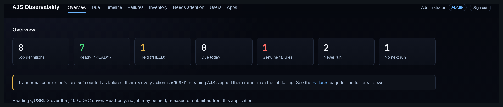
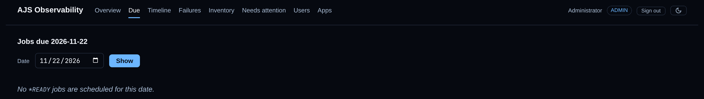

# AJS Observability

A read-only web dashboard for **IBM Advanced Job Scheduler (AJS)** on IBM i.

It answers the operational questions a 5250 session makes tedious: what is due
today, what failed, what is held or never ran, and — with the timeline view —
when jobs actually ran and how long each took.

> **This application never writes to the IBM i.** Every query is a `SELECT`, and
> the IBM i service profile it is designed to use has no `*JOBCTL` and no AJS
> function authority. Hold, release, submit, and job-definition changes are
> deliberately out of scope — see
> [Can it define and schedule jobs?](#can-it-define-and-schedule-jobs) below.



---

## What it does

| View | Path | Answers |
| --- | --- | --- |
| **Overview** | `/overview` | Counts: ready, held, due today, genuine failures, never run |
| **Due** | `/calendar` | Jobs scheduled on a given date |
| **Timeline** | `/timeline` | Every run in a date/time window, as a bar chart |
| **Failures** | `/failures` | Abnormal completions, with `*NOSBM` skips shown separately |
| **Inventory** | `/jobs` | All job definitions, grouped by application group |
| **Job detail** | `/jobs/{name}` | One job's definition plus its command list |
| **Needs attention** | `/attention` | Held and never-run jobs |
| **Administration** | `/admin/**` | Users, apps, and per-app view permissions (ADMIN only) |

### The timeline

Each run is one bar: **left edge = start time, width = duration**. A scheduling
pile-up or a runaway step is visible without reading numbers. The time scale is
switchable (Auto / 15 min / Hour / 6 hour / Day).

> No screenshot of the timeline is included yet: the images in `docs/screenshots/`
> predate that view. Regenerate them with the tooling in `docs/tools/`.

The other dashboards look like this:



Two deliberate behaviours worth knowing:

- **A job that was expected to run but produced nothing still appears**, as a
  dashed `not run` marker. Lanes come from the job master file, not from history
  rows, so an absence is visible rather than silent.
- **A run with no elapsed time is treated as still running**, not as zero
  duration — which would draw an in-flight job as an instantaneous success.

Bar geometry is computed server-side, so the chart renders without JavaScript.

---

## Quick start

Runs entirely offline against fabricated data. No IBM i, no Docker, no network.

```bash
./gradlew test                                              # full suite
./gradlew bootRun --args='--spring.profiles.active=local'    # run locally
```

Then browse <http://localhost:8080> and sign in with the local-profile
credentials:

```
admin@localhost / localdev1234
```

> These credentials, and the JWT secret in `application-local.yml`, are
> **deliberately public and non-secret**. That profile seeds fabricated job data
> and is guarded against starting in a deployed environment. Do not reuse them.

### Requirements

- **Java 21** (Gradle provisions the toolchain automatically if missing)
- No database to install — the offline profiles use in-memory H2 and a local
  SQLite file for accounts

---

## Architecture

Two **entirely separate** datasources. Conflating them is the easiest mistake to
make here.

```
        AJS data (READ-ONLY)                 Accounts (read-write)
   ┌──────────────────────────────┐    ┌──────────────────────────────┐
   │ jdbc:as400://  →  QUSRIJS    │    │ SQLite file                  │
   │ H2 MODE=DB2 in tests         │    │ H2 is NOT used here          │
   │ AjsRepository (interface)    │    │ UserRepository/AppRepository │
   └──────────────────────────────┘    └──────────────────────────────┘
```

Data comes from the AJS physical files — `QAIJSMST` (definitions), `QAIJSHST`
(run history), `QAIJS1CM` (command lists) — over the jt400 JDBC driver. Nothing
is installed on the IBM i; these are the same tables the 5250 panels read.

**Why `AjsRepository` is an interface:** the jt400 driver accepts only
`jdbc:as400:` URLs and will not talk to H2. To test with no IBM i present, the
SQL boundary has to have a second implementation. That abstraction *is* the
offline test strategy — it is not incidental. Do not simplify it away.

| Layer | Location |
| --- | --- |
| Domain + legacy date decoding | `src/main/java/com/example/ajs/domain/` |
| SQL (read-only) | `.../repository/` |
| View logic (tested, not in templates) | `.../service/` |
| Controllers | `.../web/` |
| Accounts, JWT, permissions | `.../auth/` |
| Thymeleaf templates | `src/main/resources/templates/` |

---

## Testing

```bash
./gradlew test
```

Four tiers, all offline:

1. **Unit** — legacy date decoding (`AjsDateDecoders`), including the CYYMMDD
   century flag and the YYMMDD pivot.
2. **Repository** — the real SQL against H2 in `MODE=DB2`, standing in for
   `QUSRIJS`.
3. **HTTP / template** — MockMvc rendering the real Thymeleaf templates.
4. **Security** — authentication, role gating, and permission enforcement.

The fixture data in `src/main/resources/fixture/` is **authored**, not extracted
from a real partition. Passing tests therefore prove the application logic and
the SQL shape are sound. They do **not** prove that a real `QAIJSMST` has these
columns. See *Known assumptions* below.

---

## Can it define and schedule jobs?

**Technically yes; deliberately not done, and I recommend it stays that way.**

The blocker is authority, not code. AJS enforces its **own** function-authority
model on top of IBM i object authority: `*USE` on the `ADDJOBJS` command is
provably insufficient — IBM documents this as message `IJS1098`, and the grant
has to be made inside AJS itself (`GO JS` → System Controls → Work with Function
Authorities). Writing therefore requires a **second, privileged profile**, which
contradicts the read-only posture this tool is built on.

Roughly: trigger and hold/release are low-difficulty and bounded; **define and
schedule are high-difficulty** — on the order of fifty parameters, no
transactional safety, and a command-sequence injection surface. Full reasoning,
including why writing `QAIJSMST` directly and screen-scraping `WRKJOBJS` are
both dead ends, is in [`NOTES.md`](NOTES.md).

---

## Known assumptions and open questions

These are unverified and matter. In priority order:

1. **The `QUSRIJS` layouts are assumed, not confirmed.** `DSPFFD QUSRIJS/QAIJSMST`,
   `QAIJSHST`, `QAIJS1CM` on a real partition and diff against
   `src/main/resources/fixture/schema-ajs.sql`. This retires the largest
   assumption in the project (risk R1), including the `QAIJSHST` key.
2. **Whether `QAIJSHST` holds one row per run or one per *step*** is unknown; the
   fixture assumes per-run.
3. **DRDA/JDBC connectivity** must be permitted by network policy (R5).
4. **`QSYS2.ACTIVE_JOB_INFO`** availability depends on the installed PTF level (R4).
5. **Multi-partition support** is not designed for.

Run with `ajs.schema-validation.enabled=true` against a partition — it logs
exactly which expected columns are missing.

---

## Documentation

| File | Contents |
| --- | --- |
| [`NOTES.md`](NOTES.md) | Engineering log: bugs caught, infrastructure traps, design rationale |
| [`docs/DESIGN-CRITIQUE.md`](docs/DESIGN-CRITIQUE.md) | Honest critique of this design and a handoff guide — **read this if you are taking over** |
| [`req.txt`](req.txt) | Original requirements, including still-open questions |
| [`docs/README.pdf`](docs/README.pdf) | Illustrated walkthrough |
| [`docs/tools/`](docs/tools/) | Tooling that generates the illustrated README from the running app |

### Before you change anything

- **Do not add write operations** without reading the feasibility section in
  `NOTES.md` first. If write support is ever genuinely needed, it should arrive
  as a separate interface with its own datasource and profile, so the read-only
  path cannot be widened by accident.
- **Domain rules belong in Java, not in Thymeleaf expressions.** Template
  expressions are untestable, and a parse error there returns **HTTP 200 with a
  truncated page** — the response streams before it fails. If you add template
  logic, assert the page's *tail* rendered, not just that an expected string
  appears.
- **Legacy date arithmetic lives only in `AjsDateDecoders`.** A naive cast raises
  SQL0181/CPD4019 on a real partition.

---

## Security

- Accounts are stored in SQLite with bcrypt hashes; sessions are stateless JWT
  cookies (`SameSite=Lax`).
- Dashboards require authentication; `/admin/**` requires the `ADMIN` role.
- Per-app permissions filter what a non-admin can see.

**Known weakness:** CSRF protection is currently disabled. The session cookie's
`SameSite=Lax` attribute is the only mitigation protecting ten state-changing
form POSTs, including admin user deletion. This is documented as **C1** in
[`docs/DESIGN-CRITIQUE.md`](docs/DESIGN-CRITIQUE.md), with the fix — which is
small, because Thymeleaf's `th:action` injects CSRF tokens automatically.

Production deployments need a real JWT secret; `JwtService` refuses to start with
a blank one.

---

## License

No license file is currently included, which means all rights are reserved by
default. Add one before accepting external contributions.
